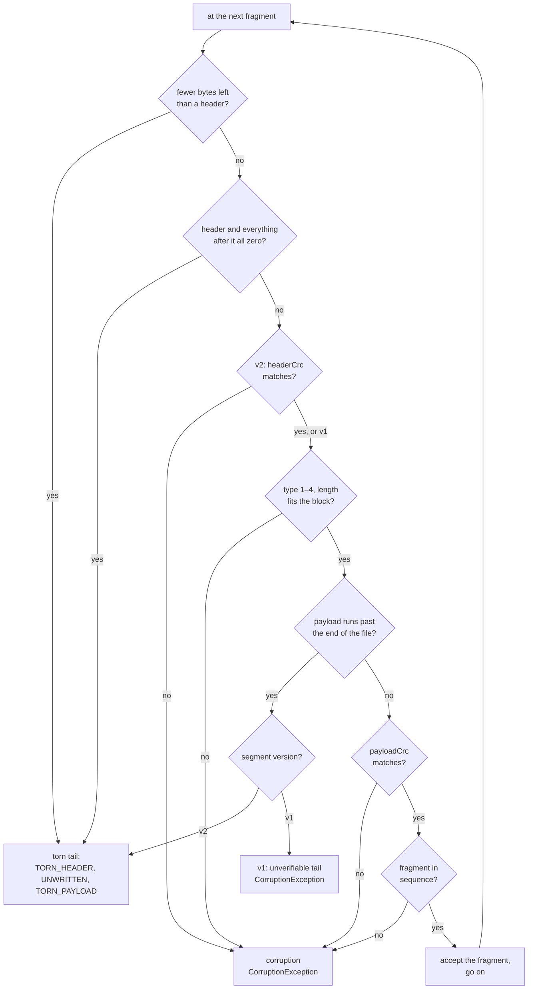

# M4.5 as-built — integrity boundaries: a recovery case study

The detail behind the "integrity boundaries" row of the [README](../../README.md). Everything here
is in the code at tag `m4.5-integrity`. The decision is
[ADR-0024](../adr/0024-recovery-integrity-boundaries.md); the byte layout is
[`internal/log/format.md`](../../shale-core/src/main/java/dev/shale/internal/log/format.md); the
plan was [M4.5](../roadmap/m4-5-integrity-boundaries.md).

M4.5's one sentence: **recovery, and every decoder, now decides only on bytes it has verified — so
the two one-bit header faults that made M4 open an empty database and delete its log now fail
loudly, with every input left exactly as it was.**

---

## 1. In the whole project — why this milestone exists

The engine's durability claim is "no acknowledged write is lost". An external review of M4 found
two different one-bit changes to a WAL fragment header that falsified it. `open` succeeded, every
acknowledged `SYNC` write was gone, and recovery then deleted the WAL that held them. Four more
decoders trusted a length or a count before checking it.

This had to come before M5. M5's manifest reuses the WAL's framing, and a manifest that misreads
a damaged length as a torn tail drops file edits — the record of which tables exist. Fixing the
framing first means the manifest is born on a framing whose every decision can be argued.

What M4.5 hands on:
- **`dev.shale.internal.log`**: the block framing as a shared package (`LogWriter`, `LogReader`,
  `LogReadResult`). The WAL uses it now; the manifest will use it at M5.
- **A decoder contract** (ADR-0024 §6) every later format follows: decode wide, check against the
  bytes remaining by subtraction, consume exactly, throw `CorruptionException` and nothing else.
- **A test discipline**: bit flips at every *bit*, cuts at every offset, and malformed structures
  with valid checksums.

## 2. The case study

### 2.1 The invariant

A crash mid-append leaves a **torn tail**: bytes never fully written, so never acknowledged, so
safe to drop. Bytes that were written and then changed are **corruption**: never repaired
silently (N4). Recovery must tell the two apart, and it may decide *only on bytes it has verified*.
A decision taken on an unverified field is a guess, and a guess that can say "torn" can delete
acknowledged data.

### 2.2 Two counterexamples

The review's fixture is two `SYNC` puts, `A`→`ack-A` and `B`→`ack-B`: a 62-byte v1 segment, now
frozen as `golden/wal/v1/two-puts.wal`. The first fragment header is at offset 16:
`payloadCrc` at 16–19, `length` at 20–21, `type` at 22.

| | One bit | What the M4 reader did | Why the CRC never saw it |
|---|---|---|---|
| **SH-08** | byte 22, bit 0: type `FULL` (1) → `ZERO` (0) | took `ZERO` as padding and skipped the block | the `ZERO` branch ran *before* any CRC check |
| **SH-18** | byte 21, bit 6: `length` 16 → 16,400 | saw a payload running past the end of the file: "torn", stop | the CRC covers `type ‖ payload`, not `length`, and the claimed payload is not in the file to check |

Both ended the same way: zero records recovered, a clean-looking `open`, and the recovery flush
deleting the WAL.

### 2.3 Why the tempting patches were not enough

- **Fix only the `ZERO` branch.** That closes SH-08 and leaves SH-18 untouched: the two bugs are
  in different fields.
- **Add `length` to the payload CRC.** This catches a damaged length *inside* the file. But in
  SH-18 the claimed payload runs past the end of the file, so there is nothing to compute the CRC
  over. The reader still has to classify the tail on a length it cannot check.
- **Make recovery `STRICT`.** It rejects both faults, and every genuine crash mid-append too: any
  `kill -9` during a write would then need an operator. It trades silent loss for unavailability
  and still cannot tell the two apart.

### 2.4 The decision: verify the header before believing it

Log framing v2 appends a **header checksum** to each fragment header:

```
v1 (7 bytes):   payloadCrc(4) ‖ length(2) ‖ type(1)
v2 (11 bytes):  payloadCrc(4) ‖ length(2) ‖ type(1) ‖ headerCrc(4) = CRC32C over the first 7
```

The reader checks `headerCrc` before it uses `length` or `type` for anything. A verified header
whose payload runs past the end of the file is then a genuine torn append; a header that fails
its checksum is corruption, wherever it is. How the reader classifies what it finds, first match
wins:



Three details that make the table sound:
- **The all-zero check comes first.** A filesystem can expose allocated-but-unwritten space as
  zeros after a crash. A v2 header of seven zero bytes has CRC32C `0xBB3E6A6D`, so it could never
  pass its own check; without this row, a zero-filled tail would read as corruption.
- **Only the newest segment may be torn.** A segment is now synced when it is closed at a
  memtable switch (`WalWriter.close`), so a crash can only cut the segment being written. A torn
  tail in any older segment is corruption naming the segment.
- **A refused `open` changes nothing.** Every throw happens before the recovery flush writes a
  table or deletes a segment.

### 2.5 Old v1 segments: honest limits instead of a guess

Segments written before M4.5 have no header checksum, and they are still read. For them:
- a `ZERO` type is accepted only as the start of an all-zero tail (closes SH-08 for v1);
- block padding must be zero;
- **a complete header whose payload runs past the end of the file is *unverifiable*,** and is
  refused under every policy. The message names the file, the offset, the claimed and present
  bytes, and the truncation an operator would make to accept the loss:

  ```text
  unverifiable WAL tail in two-puts.wal at offset 16: header claims 16400 payload bytes,
  39 present; v1 cannot tell a torn append from a damaged length — to accept losing this
  tail, truncate the file to 16 bytes and reopen
  ```

The cost is stated, not hidden: a *genuine* crash mid-payload in a v1 segment no longer opens on
its own. Such segments exist only in directories written before M4.5, and only until their first
recovery.

### 2.6 The other decoders

| Finding | Decoder | What was wrong | Now |
|---|---|---|---|
| SH-11 | `Varints.get` | a tenth byte of `0x02` wrapped to 0 | the tenth byte must be 0 or 1 |
| SH-13 | `WalRecordCodec.decode` | key length 2^32 + 9 narrowed to 9 and matched the 9 bytes present | lengths are `varint32` (`getUnsigned32`), checked as `long`s against the bytes remaining; trailing bytes are corruption |
| SH-14 | `Block` | (1 + count) · 4 overflowed `int`: a 24-byte block claimed 1,073,741,825 restarts | the count is bounded before any multiplication; restart offsets start at 0, increase, stay in the entry region, and point at `shared == 0` entries |
| SH-15 | `SSTableReader.open` | a footer naming the valid, empty metaindex as the index opened an empty table | the v1 layout is checked: index ends at the footer, metaindex at the index, data handles before the metaindex |
| SH-16 | `SSTableReader.readBlock` | bad sizes escaped as `ArithmeticException` or an out-of-bounds read | offset and size are checked by `long` subtraction before narrowing |

None of these changes a byte on disk: each describes what the writer has always produced.

### 2.7 What it found on the way

The v2 encoder was written after its format was specified, and the worked example's two CRCs were
computed by an implementation independent of Shale's. That caught a real bug. The payload CRC was
computed from offset 6 for `1 + length` bytes, which is `type ‖ payload` only while the payload
starts at offset 7. In v2 it covered the `headerCrc` slot instead of the payload's last four
bytes. The writer and the reader shared the mistake, so every Java round trip passed; the
independent reader rejected the first v2 golden.

## 3. Low-level design

| Type | Package | Role |
|---|---|---|
| `LogWriter` | `dev.shale.internal.log` | frames records into fragments and blocks; v1 or v2; `sync()` holds the `// DURABILITY:` force |
| `LogReader` | `dev.shale.internal.log` | verifies, reassembles and classifies a file's end; applies no policy |
| `LogReadResult` | `dev.shale.internal.log` | records, end offset, tail (`CLEAN`, `TORN_FILE_HEADER`, `TORN_HEADER`, `UNWRITTEN`, `TORN_PAYLOAD`, `OPEN_RECORD`), tail offset |
| `RecordType` | `dev.shale.internal.log` | the fragment type byte (moved from `dev.shale.wal`, as in LevelDB's `log_format.h`) |
| `WalWriter` | `dev.shale.wal` | the WAL's file header and durability contract; writes v2; syncs on `close()` |
| `WalReader` | `dev.shale.wal` | the WAL's file header; `read(Path)` reports the tail, `readAll` applies `RecoveryPolicy`; v1's unverifiable rule |
| `Shale.open` / `replay` | `dev.shale` | only the newest segment may be torn |

Threading and ownership are unchanged: `LogWriter` is owned by its `WalWriter`, which the engine's
write path serialises; `LogReader` is stateless.

## 4. What proves it

| Behaviour | Test |
|---|---|
| Every bit of every v2 header and padding byte, and of the small goldens, is corruption; every byte of the large ones (crash tier) | `wal/LogV2BitFlipTest` |
| Every cut keeps exactly the records ending before it, and names the tail from the golden's layout | `wal/LogV2TruncationTest` |
| The review's matrix per fragment header; SH-18 on v2 is a header CRC mismatch | `wal/LogV2HeaderMatrixTest` |
| Random record sizes at any block position round-trip, v1 and v2 | `wal/LogFramingPropertyTest` |
| All seven WAL goldens decode; v2 `single-put` matches `format.md` §4 byte for byte | `wal/GoldenWalTest` |
| SH-08 on v1; zero-filled tails; non-zero padding | `wal/WalTest` |
| SH-18 on v1 is unverifiable; the availability cost; never a silent loss at any cut | `wal/WalV1TailTest` |
| Newest-segment rule; sync on switch; the review's engine history; refused opens change nothing; the operator's procedure | `ShaleRecoveryBoundaryTest` |
| SH-11, SH-13 | `internal/coding/VarintsTest`, `wal/WalRecordCodecTest` |
| SH-14; SH-15 and SH-16; every bit of a small table | `sstable/BlockTest`; `sstable/SSTableTest` |

Mutation checks were run by hand while building: removing the header CRC check fails 17 framing
tests; removing the v1 rule fails 7 of 8 v1 tail tests; removing the newest-segment rule fails 3
boundary tests, and removing the sync on close fails 1.

## 5. The limits that remain

- **Physical power loss is not tested.** M5's `FaultInjectionEnv` simulates it; real hardware is
  argued from fsync ordering only. Directory entries are not yet synced (M5).
  *(From M5 they are, and simulated power loss is tested: see the
  [M5 explainer](m5-manifest-and-recovery.md).)*
- **A garbage power-loss tail is corruption.** A tail that is neither zeros nor a byte-prefix of
  what was written is refused; journaling filesystems in their default modes do not produce one.
- **v1 tails cost availability**, as §2.5 says.
- **CRC32C detects accidental damage.** It is not authentication.
- **Repeated refused opens leak table handles** until M5's open rollback (SH-02). *(Fixed in M5.)*
