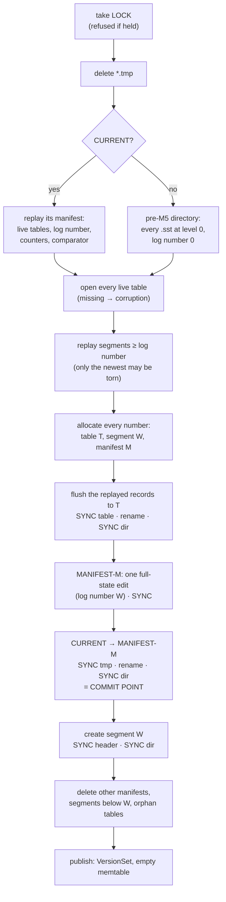
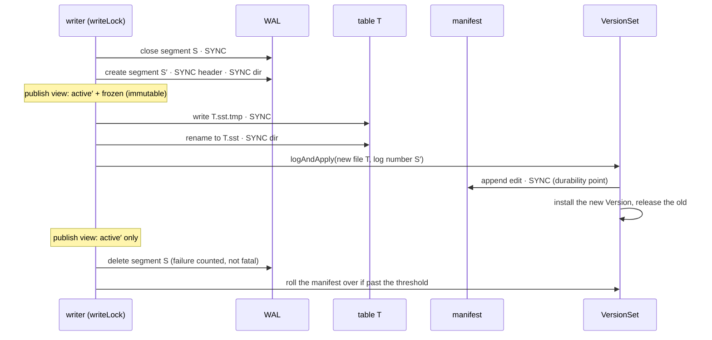
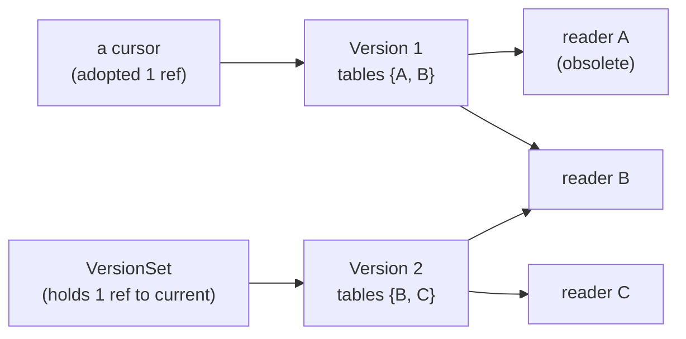

# M5 as-built — manifest and recovery

The detail behind the "manifest and recovery" row of the [README](../../README.md). Everything here
is in the code at tag `m5-manifest`. The decision is
[ADR-0012](../adr/0012-manifest-and-recovery.md); the byte layout is
[`manifest/format.md`](../../shale-core/src/main/java/dev/shale/manifest/format.md); the plan was
[M5](../roadmap/m5-manifest-and-recovery.md).

M5's one sentence: **the set of live files now comes from a durable manifest, not from listing the
directory — so a file can be deleted exactly when nothing durable and no reader refers to it, and
every write path's durability is tested under simulated power loss.**

---

## 1. In the whole project — why this milestone exists

Until M5 the engine trusted the directory: every `NNNNNN.sst` was a table, every `NNNNNN.wal` a
segment to replay. That works only while no file is ever deleted. Compaction (M6) must delete its
inputs, and a database whose authority is the directory cannot tell "this table replaced those
three" from "these four tables are live". So M5 adds the manifest first.

On the way it closes every lifecycle gap the October 2026 review found in M4 (SH-01, SH-02,
SH-04, SH-09, SH-10; [bug log](../bug-log.md) B7, B8), and builds the harness that tests
durability under power loss, not only process death (SH-05).

What M5 hands on:
- **`dev.shale.manifest`**: `VersionEdit`, `ManifestWriter`/`ManifestReader`, `CurrentFile`,
  `Version`, `VersionSet`. M6's compaction is one more caller of `VersionSet.logAndApply`, with
  deleted files as well as new ones.
- **`dev.shale.env`**: the public `Env` seam, and `FaultInjectionEnv` in `shale-core`'s test
  fixtures, for every later layer's crash tests (ShaleDB's included).
- **`ShaleOptions`**, the options record later milestones extend.

## 2. High-level design

### 2.1 Files in a database directory

| Name | What | Written how |
|---|---|---|
| `LOCK` | held with `tryLock` while an engine is open | created once, never written |
| `CURRENT` | `MANIFEST-NNNNNN\n` | `CURRENT.tmp`, sync, rename, directory sync |
| `MANIFEST-NNNNNN` | log of version edits, framing v2 | one full-state edit, then one synced edit per flush |
| `NNNNNN.wal` | WAL segment | header synced and directory synced at creation; records synced per `Durability` |
| `NNNNNN.sst` | table | `.sst.tmp`, sync, rename, directory synced |
| `*.tmp` | an unfinished write | deleted at open, never read |

One counter numbers every file; `%06d` is a minimum width, and names are ordered by number.

### 2.2 Opening a database

Every sync is marked; the commit point is the `CURRENT` switch. Nothing is deleted before it, so a
refused open changes no input, and a crash anywhere leaves either the old state or the new one.

If any step before publishing throws, `Recovery` releases everything it acquired — readers, the
manifest writer, the WAL writer — in reverse order (SH-02), and `Shale.open` releases `LOCK`.

### 2.3 A flush

Any I/O failure up to and including the edit puts the engine in the **failed state**: the write
that triggered the flush returns normally (it was durable to its mode before the flush began),
later writes throw `EngineStateException` with the cause, and reads keep the frozen memtable
until a reopen recovers from durable state (SH-01).

### 2.4 When a table file is deleted

An edit that removes `A` installs Version 2 and marks `A`'s reader obsolete. Version 1 lives on
while a cursor holds it; when the cursor closes, Version 1's count reaches zero, it releases its
readers, `A`'s count reaches zero, and the release closes **and deletes** `A.sst`. A file
disappears exactly when it is out of the durable Version and no reader holds it. In M5 only a test
deletes tables through an edit; M6's compaction is the first production caller.

## 3. Low-level design

| Type | Package | Role |
|---|---|---|
| `Env`, `WritableFile`, `ReadableFile`, `PosixEnv` | `dev.shale.env` | every file operation; `sync` is `force(true)`, `syncDirectory` forces the directory |
| `FaultInjectionEnv`, `SimulatedCrash` | `dev.shale.env` (test fixtures) | indexed trace, `crashAt`, `failOn`, `dropUnsyncedData(DropMode, EntryLoss, seed)`, `openHandles` |
| `ShaleOptions` | `dev.shale` | write buffer, manifest rollover, `Env` |
| `VersionEdit`, `FileMetadata`, `VersionEditCodec` | `dev.shale.manifest` | one change to the file set; tags 1–7, tag 7 with sequence ranges |
| `ManifestWriter`, `ManifestReader`, `CurrentFile` | `dev.shale.manifest` | the manifest on framing v2 with magic `ShaleMAN`; `CURRENT` |
| `ManifestState` | `dev.shale.manifest` | what replaying edits adds up to; writes itself back as a full-state edit |
| `Version`, `VersionSet` | `dev.shale.manifest` | reference-counted file sets; `logAndApply`, rollover, failure |
| `Recovery`, `FileNames` | `dev.shale` (package-private) | the open sequence with rollback; file names and numbers |
| `Shale` | `dev.shale` | flush through the manifest; the failed state; reads through a retained Version |

**Threading.** `writeLock` (the engine) ranks above `versionLock` (the `VersionSet`). Readers
take one volatile read of the memtable view, *then* retain the current Version from the
`VersionSet`: a flush installs its Version before publishing the view without the frozen memtable,
so the Version a reader retains always holds whatever that view lacks. Retaining through the
`VersionSet`, under its lock, also means a reader can never retain a Version whose count has
already reached zero.

**Decisions taken while building** (recorded in ADR-0012 and the plan):
- The `Env` is an option (`ShaleOptions.env`), as in LevelDB's `Options::env`, rather than a fifth
  `open` parameter.
- `FaultInjectionEnv` can keep unsynced *deletes* while undoing everything else
  (`EntryLoss.KEEP_DELETES`): before a directory sync POSIX orders nothing, and that subset is
  the one that loses data. Without it, the missing directory sync after a flush's rename could not
  be observed.
- `open` allocates every file number it needs before writing anything, so running out of numbers
  is refused with every input intact.

## 4. What proves it

| Behaviour | Test |
|---|---|
| The `Env` contract | `env/EnvContractTest` |
| The harness loses exactly what POSIX allows | `env/FaultInjectionEnvTest` |
| Manifest v2: golden (independently written), every bit, every cut, round trips, rejections | `manifest/GoldenManifestTest`, `ManifestBitFlipTest`, `VersionEditCodecPropertyTest`, `VersionEditCodecTest`, `CurrentFileTest` |
| Deletion only when obsolete and unreferenced; failed sync installs nothing; replay; rollover | `manifest/VersionSetTest` |
| Recovery through the manifest; SH-01, SH-02, SH-10; refused opens change nothing | `ShaleManifestRecoveryTest` |
| Close, rejection after close, `LOCK` | `ShaleLifecycleTest` |
| File numbers past six digits (SH-09) | `ShaleFileNumberTest` |
| `SYNC` survives power loss at every operation (SH-04) | `ShalePowerLossTest` (crash tier) |
| Six workloads × every operation × both loss models: acks kept, nothing invented, no duplicate key, `get` = `scan` | `ShaleCrashMatrixTest` (crash tier) |
| One history, eight configurations, one answer | `EngineMetamorphicTest` |

Mutation checks run while building: dropping the directory sync after a flush's rename fails three
crash-matrix workloads; recording the frozen segment as the log number fails three with a
duplicated internal key. The matrix passed for 20 `TORN` seeds.

## 5. The limits that remain

- **Physical power loss is not tested.** The harness models POSIX's guarantees; a device that
  lies about `fsync` is out of reach (ADR-0024 §7).
- **Flush is synchronous** under the write lock, and a `SYNC` write still holds that lock across
  its fsync (concurrency-and-resources.md §2's known deviation): M5.5 moves both.
- **Only level 0 exists**, and nothing but a test deletes a table through an edit: M6.
- **A failed flush needs a reopen.** Retrying in place was rejected (ADR-0012).
- **A leaked cursor pins its Version**, and so its tables, until it is closed.
